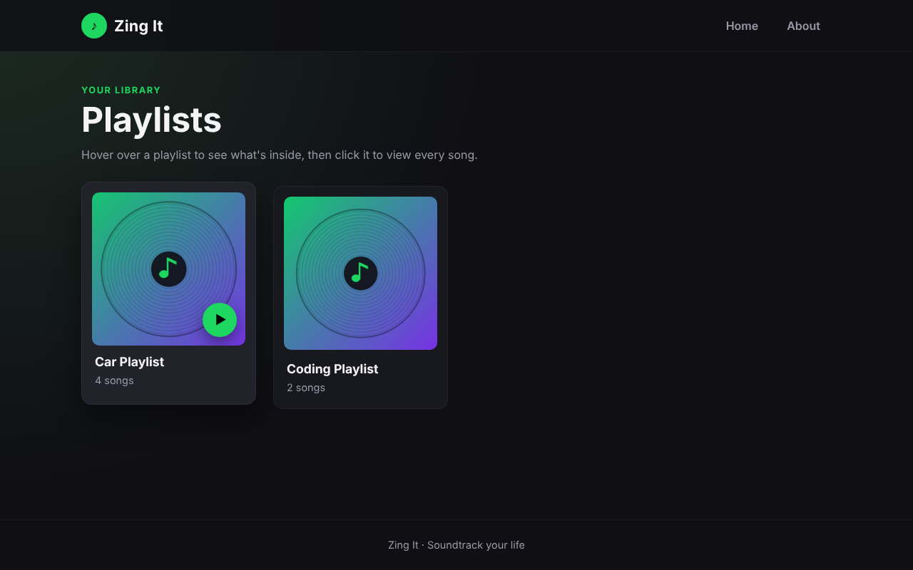
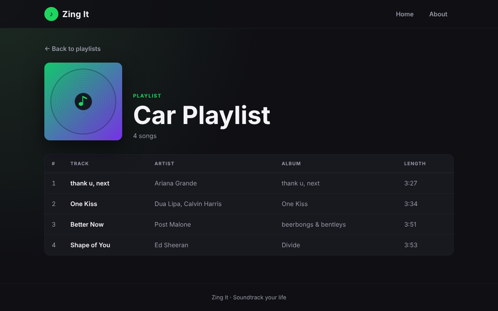
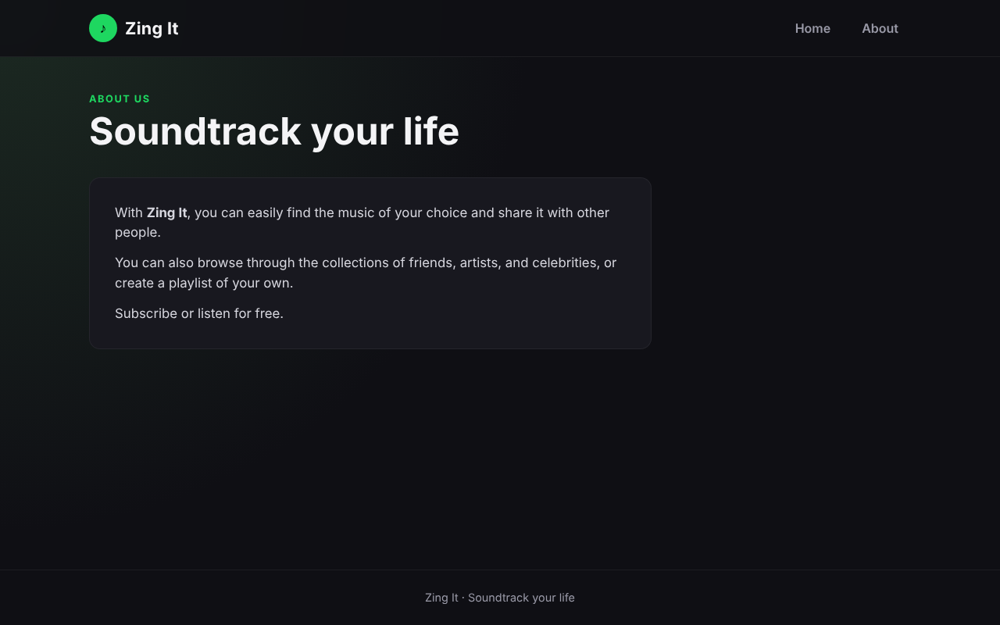
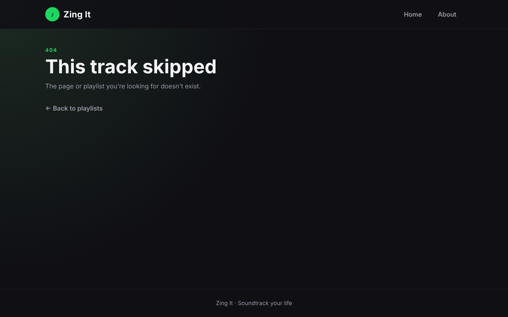

<div align="center">

# Zing It

### A multi-page music playlist web app built step by step with Django




</div>

---

<details>
<summary><b>Table of contents</b></summary>

- [Overview](#overview)
- [TL;DR: Run it in 30 seconds](#tldr-run-it-in-30-seconds)
- [Step 0: Understand the project layout](#step-0-understand-the-project-layout)
- [Step 1: Render the home template](#step-1-render-the-home-template)
- [Step 2: Display every playlist with the for tag](#step-2-display-every-playlist-with-the-for-tag)
- [Step 3: Implement the playlist view (with a real 404)](#step-3-implement-the-playlist-view-with-a-real-404)
- [Step 4: Configure the dynamic route](#step-4-configure-the-dynamic-route)
- [Step 5: Build the songs template](#step-5-build-the-songs-template)
- [Step 6: Link cards with the url tag](#step-6-link-cards-with-the-url-tag)
- [Step 7: Create a base template](#step-7-create-a-base-template)
- [Step 8: Extend the base in every page](#step-8-extend-the-base-in-every-page)
- [Step 9: Serve your own cover art](#step-9-serve-your-own-cover-art)
- [Going further: production-ready extras](#going-further-production-ready-extras)
- [What we learned](#what-we-learned)

</details>

## Overview

Every music app you've ever used, whether it's Spotify, Apple Music or YouTube Music, comes down to the same few pages: a library of playlists, a page for each playlist with its tracks, and a few static pages around them. That makes a playlist app a good first real project in Django. It's small enough to finish in an afternoon, and it uses nearly every core idea the framework is built on.

In this post we'll build **Zing It**, a multi-page music playlist app, step by step. By the end you'll have:

- A home page that renders a card for every playlist
- A dynamic `/playlist/<id>/` page that lists that playlist's songs, with a proper **404** for missing playlists
- An About page
- A shared base layout using **template inheritance**
- Cover art served through Django's **static files** system
- A test suite, a `Dockerfile`, and a one-command `run.sh` script

Let's get into it.

---

## TL;DR: Run it in 30 seconds

```bash
git clone https://github.com/Mian-Basam/zing-it-django-music-playlist.git
cd zing-it-django-music-playlist
chmod +x run.sh

./run.sh            # local dev server  → http://127.0.0.1:8000
./run.sh docker     # or run it in Docker
```

| Command | What it does |
|---|---|
| `./run.sh` / `./run.sh local` | Creates a virtualenv, installs dependencies, and starts Django's dev server |
| `./run.sh prod` | Runs with Gunicorn and `DEBUG=False`, the same way it runs in production |
| `./run.sh test` | Runs the test suite |
| `./run.sh docker` | Builds the Docker image and starts a container |
| `./run.sh docker-stop` | Stops and removes the container |

Set `PORT` to change the port, for example `PORT=9000 ./run.sh`.

---

## Step 0: Understand the project layout

Django splits a web application into a **project**, which holds global configuration, and one or more **apps**, which hold the features. Zing It has a single app that powers every page.

```
zing-it-django-music-playlist/
├── manage.py
├── django_project/          # Project configuration
│   ├── settings.py          # Registers the app, templates, and static folders
│   ├── urls.py              # Forwards every request to the app's routes
│   └── wsgi.py / asgi.py
├── zing_it/                 # The app
│   ├── views.py             # Data (my_playlists, my_songs) + view functions
│   ├── urls.py              # URL patterns → views
│   └── tests.py             # Test suite
├── templates/
│   ├── 404.html
│   └── zing_it/
│       ├── base.html        # Shared parent layout
│       ├── home.html        # Playlist cards
│       ├── songs.html       # Songs table for one playlist
│       └── about.html
├── static/zing_it/
│   ├── css/                 # style.css, home.css, songs.css
│   └── images/music.jpg     # Cover art
├── Dockerfile
├── run.sh
└── requirements.txt
```

The project-level `urls.py` does exactly one job: it hands every request to the app.

```python
# django_project/urls.py
from django.urls import include, path

urlpatterns = [
    path("", include("zing_it.urls")),
]
```

The "database" for this app is two plain Python lists in `views.py`. Each song carries a `playlist_id` that ties it to a playlist:

```python
my_playlists = [
    {"id": 1, "name": "Car Playlist", "numberOfSongs": 4},
    {"id": 2, "name": "Coding Playlist", "numberOfSongs": 2},
]

my_songs = [
    {"id": 1, "Track": "thank u, next", "Artist": "Ariana Grande",
     "Album": "thank u, next", "Length": "3:27", "playlist_id": 1},
    {"id": 2, "Track": "One Kiss", "Artist": "Dua Lipa, Calvin Harris",
     "Album": "One Kiss", "Length": "3:34", "playlist_id": 1},
    # ...four more songs
]
```

---

## Step 1: Render the home template

A view takes a request and returns a response. You *could* return raw HTML strings with `HttpResponse`, but that gets messy quickly. Templates keep the layout separate from the Python logic, and the view passes data to the template through a **context dictionary**.

```python
from django.shortcuts import render

def home(request):
    return render(request, "zing_it/home.html", {"my_playlists": my_playlists})
```

The `my_playlists` key is now available inside `home.html`.

---

## Step 2: Display every playlist with the `for` tag

Writing one card per playlist by hand doesn't scale. The Django template language's `` tag repeats a block once per item, and `{{ variable }}` injects values:

```django
<div class="playlist-grid">
  
    <a class="playlist-card" href="#">
      <div class="cover">
        
        <span class="play-btn">▶</span>
      </div>
      <div class="details">
        <h2>{{ playlist.name }}</h2>
        <span>{{ playlist.numberOfSongs }} songs</span>
      </div>
    </a>
  
</div>
```

Note the dot syntax: `playlist.name` works on dictionaries, attributes and methods alike. Hover over a card and it lifts, a play button pops in, and the details slide up, all in pure CSS.

---

## Step 3: Implement the playlist view (with a real 404)

We don't want one view per playlist. One view can receive the playlist `id` from the URL and decide what to show. If someone asks for a playlist that doesn't exist, the right answer is **404 Not Found**, not an empty page.

```python
from django.http import Http404

def playlist(request, id):
    songs = []
    for song in my_songs:
        if song["playlist_id"] == id:
            songs.append(song)

    if not songs:
        raise Http404("Playlist does not exist")

    playlist_name = ""
    for item in my_playlists:
        if item["id"] == id:
            playlist_name = item["name"]

    return render(
        request,
        "zing_it/songs.html",
        {"songs": songs, "playlist_name": playlist_name},
    )
```

Raising `Http404` lets Django render the `404.html` template when `DEBUG` is off.

---

## Step 4: Configure the dynamic route

A view only becomes reachable when a URL pattern points to it. **Path converters** let one pattern match many addresses: `<int:id>` matches `/playlist/1/`, `/playlist/2/` and so on, and passes the number to the view as `id`.

```python
# zing_it/urls.py
from django.urls import path
from zing_it import views

urlpatterns = [
    path("", views.home, name="home"),
    path("about/", views.about, name="about"),
    path("playlist/<int:id>/", views.playlist, name="playlist"),
]
```

As a bonus, `/playlist/abc/` doesn't match at all because `int` only accepts digits, so it returns a 404 too.

---

## Step 5: Build the songs template

`songs.html` shows the playlist name, a song count using the `length` filter, and a table row per song. `forloop.counter` gives us a 1-based track number for free.

```django
<h1>{{ playlist_name }}</h1>
<p>{{ songs|length }} songs</p>

<tbody>
  
    <tr>
      <td class="track-number">{{ forloop.counter }}</td>
      <td class="track-title">{{ song.Track }}</td>
      <td class="muted">{{ song.Artist }}</td>
      <td class="muted">{{ song.Album }}</td>
      <td class="muted">{{ song.Length }}</td>
    </tr>
  
</tbody>
```



---

## Step 6: Link cards with the `url` tag

Hardcoding `/playlist/1/` breaks the moment you rename a route. The `` tag builds the address from the route's **name**:

```django
<a class="playlist-card" href="">
```

Now clicking a card opens its songs page, and if you change the route later, every link updates automatically.

---

## Step 7: Create a base template

At this point all three pages repeat the same `<head>`, navbar and footer. **Template inheritance** fixes that: a parent template defines the shared layout and leaves named `block`s for children to fill in.

```django
<!DOCTYPE html>

<html lang="en">
<head>
  <meta charset="UTF-8">
  <title>Zing It</title>
  <link rel="stylesheet" href="">
  
</head>
<body>
  <header class="navbar">...</header>
  <main class="container">
    
  </main>
  <footer class="footer">Zing It · Soundtrack your life</footer>
</body>
</html>
```

Three blocks: `title` (with a default), `css` (for page-specific stylesheets) and `content`.

---

## Step 8: Extend the base in every page

Each child starts with `` and overrides only the blocks it needs. Anything outside a block in a child template is ignored, so all the duplicated markup goes away:

```django



Home | Zing It


  <link rel="stylesheet" href="">



  ...page-specific markup...

```

A gotcha worth remembering: `` has to appear in **every** template that uses ``. Loaded tag libraries are not inherited from the parent.



---

## Step 9: Serve your own cover art

The original covers came from a remote URL. If that site goes down, your app breaks. Production apps serve their own assets as **static files**, and the `` tag builds the correct URL for them:

```django

```

In production, `collectstatic` gathers everything into `staticfiles/`, and [WhiteNoise](https://whitenoise.readthedocs.io/) serves it with hashed filenames (for example `music.f98d8e916118.jpg`) and far-future cache headers. No Nginx needed.

---

## Going further: production-ready extras

The guided project stops at Step 9. This repo adds what you'd want before shipping:

### Environment-based settings

`settings.py` reads its config from environment variables, so the same code runs everywhere:

| Variable | Default | Purpose |
|---|---|---|
| `DJANGO_DEBUG` | `True` | Debug mode (`False` in Docker) |
| `DJANGO_SECRET_KEY` | dev key | **Set this in production** |
| `DJANGO_ALLOWED_HOSTS` | `*` | Comma-separated hostnames |
| `DJANGO_CSRF_TRUSTED_ORIGINS` | *(empty)* | For HTTPS deployments |
| `PORT` | `8000` | Port for Gunicorn / runserver |

### Tests

`zing_it/tests.py` covers every page: playlists rendering and linking, the right songs per playlist, the 404 for missing and non-numeric IDs, template inheritance, and static cover art.

```bash
./run.sh test
# Ran 7 tests ... OK
```

### Docker

The `Dockerfile` uses `python:3.12-slim`, installs dependencies in a cached layer, runs `collectstatic` **and the test suite at build time** (a failing test fails the build), switches to a non-root user, and serves the app with Gunicorn behind a health check.

```bash
docker build -t zing-it .
docker run -p 8000:8000 -e DJANGO_SECRET_KEY=change-me zing-it
```

Or let the script do it: `./run.sh docker`.



---

## What we learned

In a few hundred lines we touched most of Django's core:

- **Views and `render()`** with a context dictionary
- **Template tags and filters**: `for`, `url`, `static`, `length`, `forloop.counter`
- **Dynamic routes** with path converters
- **`Http404`** for missing resources
- **Template inheritance** with `extends` and `block`
- **Static files**, served in production with WhiteNoise
- **Testing** with `SimpleTestCase`, plus **Docker** and **Gunicorn** for deployment

Good next steps: move playlists and songs into Django **models** with SQLite or Postgres, add a form to create playlists, or plug in an audio player.

Happy building!

---

*Based on the Educative guided project "Build a Music Playlist App Using Django."*

---

<div align="center">

**Built by [Mian Basam Ahmad](https://github.com/Mian-Basam)** · Software Engineer & Tech Lead

[](https://mian-basam.github.io) [](https://www.linkedin.com/in/mian-basam-ahmad-68b997147/) [](https://github.com/Mian-Basam)

<sub>If this project helped you, consider giving it a ⭐</sub>

</div>
